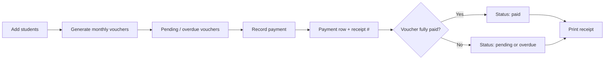

# School Fee Management System

**Alchemist Digital Solution** — MVP for schools to manage students, monthly fee vouchers, fee collection, receipts/challans, and financial summaries.

| | |
|---|---|
| **Repository** | [github.com/ZA535/SchoolFeeSystem_AlchemistDigitalSolution](https://github.com/ZA535/SchoolFeeSystem_AlchemistDigitalSolution) |
| **Stack** | React (Vite) + Express (Node.js) + PostgreSQL ([Supabase](https://supabase.com)) |
| **Status** | MVP — suitable for local/school LAN use; add auth and hardening before public internet |

---

## Table of contents

1. [Features](#features)
2. [How it works (flow)](#how-it-works-flow)
3. [Project structure](#project-structure)
4. [Prerequisites](#prerequisites)
5. [Get the code (GitHub)](#get-the-code-github)
6. [Environment variables](#environment-variables)
7. [Supabase setup](#supabase-setup)
8. [Install and run locally](#install-and-run-locally)
9. [Using the application](#using-the-application)
10. [Fee collection and payments](#fee-collection-and-payments)
11. [Database schema](#database-schema)
12. [REST API reference](#rest-api-reference)
13. [NPM scripts](#npm-scripts)
14. [Git, secrets, and `.gitignore`](#git-secrets-and-gitignore)
15. [Deployment notes](#deployment-notes)
16. [Troubleshooting](#troubleshooting)
17. [Roadmap (production)](#roadmap-production)
18. [License](#license)

---

## Features

| Module | What users can do |
|--------|-------------------|
| **Dashboard** | See total expected, collected, pending, and overdue (defaulters) for the current month; generate monthly vouchers in one click |
| **Students** | Add, edit, search; fields: name, roll number, class/section, monthly fee, guardian contact |
| **Fee vouchers** | List by month; filter by class, status (paid/pending/overdue), unpaid only; challan print |
| **Collect fee** | Dedicated screen for unpaid vouchers: payment date, method, amount (full or partial), auto receipt number |
| **Receipts** | Printable receipt per payment (`RCP-YYYYMMDD-####`) |
| **Challans** | Printable fee challan for unpaid balances |
| **Partial payments** | Multiple payments per voucher; status becomes **paid** when total paid ≥ amount due |
| **Status engine** | `pending` / `paid` / `overdue` (DB trigger + optional sync) |

---

## How it works (flow)



1. **Students** store the **monthly fee** template.
2. **Generate vouchers** creates one `fee_vouchers` row per student per month (skips duplicates).
3. **Collect fee** or **Fee vouchers** → **Record payment** inserts into `payments` and updates `amount_paid`.
4. When `amount_paid >= amount_due`, the voucher is marked **`paid`** (PostgreSQL trigger).
5. Each payment gets its own **receipt number**; optional print view.

---

## Project structure

```
SchoolFeeSystem_AlchemistDigitalSolution/
├── client/                          # React 19 + Vite 6 frontend
│   ├── src/
│   │   ├── pages/                   # Dashboard, Students, Vouchers, FeeCollection, Receipt, Challan
│   │   ├── components/              # Payment forms, print layouts
│   │   ├── api.js                   # Calls /api (proxied in dev)
│   │   └── constants/
│   ├── .env.example                 # Committed template (no secrets)
│   └── vite.config.js               # Dev proxy: /api → localhost:4000
├── server/                          # Express REST API
│   ├── src/
│   │   ├── routes/                  # students, vouchers, dashboard
│   │   ├── supabase.js              # Supabase client (secret key, server only)
│   │   └── utils/                   # receipts, voucher dates, status sync
│   ├── scripts/check-supabase.mjs   # Connectivity test
│   └── .env.example
├── supabase/migrations/             # Run manually in Supabase SQL Editor
│   ├── 001_initial_schema.sql
│   └── 002_reload_schema.sql
├── .env.example                     # Root reference (optional)
├── .gitignore                       # Ignores node_modules, .env, build output
├── package.json                     # Root scripts: install:all, dev:*
└── README.md
```

---

## Prerequisites

- **Node.js** 18+ (20 LTS recommended)
- **npm** 9+
- **Supabase** account (free tier is enough for MVP)
- **Git** (to clone the repository)

You do **not** need local PostgreSQL; the database lives on **Supabase**.

---

## Get the code (GitHub)

```bash
git clone https://github.com/ZA535/SchoolFeeSystem_AlchemistDigitalSolution.git
cd SchoolFeeSystem_AlchemistDigitalSolution
```

Copy environment templates and fill in values (see below):

```bash
cp server/.env.example server/.env
cp client/.env.example client/.env
```

Install dependencies:

```bash
npm run install:all
```

---

## Environment variables

### Server — `server/.env` (required)

| Variable | Required | Description |
|----------|----------|-------------|
| `SUPABASE_URL` | Yes | `https://YOUR_PROJECT_REF.supabase.co` from **Settings → General → Project URL** |
| `SUPABASE_SERVICE_ROLE_KEY` | Yes | **Secret** key (`sb_secret_...`) from **Settings → API Keys** — server only |
| `PORT` | No | API port (default `4000`) |
| `CLIENT_ORIGIN` | No | Frontend origin for CORS (default `http://localhost:5173`) |
| `APP_TIMEZONE` | No | Optional; default thinking `Asia/Karachi` for due dates |

Example:

```env
SUPABASE_URL=https://iovwitujluqrpetdcrfj.supabase.co
SUPABASE_SERVICE_ROLE_KEY=sb_secret_xxxxxxxx
PORT=4000
CLIENT_ORIGIN=http://localhost:5173
APP_TIMEZONE=Asia/Karachi
```

> **Important:** Copy **Project URL** exactly. A single wrong character (e.g. `l` vs `io`) causes `ENOTFOUND` / `fetch failed`.

> **Legacy keys:** If the secret key fails, Supabase may still offer a JWT **service_role** key (`eyJ...`) under legacy API settings — use that as `SUPABASE_SERVICE_ROLE_KEY`.

### Client — `client/.env` (optional for MVP)

| Variable | Required | Description |
|----------|----------|-------------|
| `VITE_SCHOOL_NAME` | No | Name on printed receipts/challans |
| `VITE_API_URL` | No | Leave empty in dev (uses Vite proxy `/api`) |
| `VITE_SUPABASE_URL` | No | Not used in MVP (API goes through Express) |
| `VITE_SUPABASE_ANON_KEY` | No | Not used in MVP |

The React app talks to **Express** at `/api` in development, not directly to Supabase.

---

## Supabase setup

### 1. Create a project

1. Sign in at [supabase.com](https://supabase.com).
2. **New project** → name, database password (save it), region → wait until **Active**.

### 2. Run database migration

1. **SQL Editor** → **New query**.
2. Paste contents of `supabase/migrations/001_initial_schema.sql`.
3. **Run**.
4. Optional: run `002_reload_schema.sql` if API cannot find `sync_voucher_statuses`.

### 3. Verify tables

**Table Editor** should show:

- `students`
- `fee_vouchers`
- `payments`

### 4. Get URL and secret key

| What | Where in dashboard |
|------|---------------------|
| **Project URL** | **Settings → General** (or project home → copy URL under project name) |
| **Secret key** | **Settings → API Keys → Secret keys** → Reveal → copy `sb_secret_...` |

Never put the secret key in the browser, `client/.env`, or GitHub.

### 5. Test connection from your machine

```bash
cd server
npm run check:supabase
```

Expected: “Supabase REST API is reachable” (or HTTP `401` with wrong key — still means DNS works).

---

## Install and run locally

```bash
# From repo root
npm run install:all
```

**Terminal 1 — API:**

```bash
npm run dev:server
# → http://localhost:4000
# → http://localhost:4000/health → {"ok":true}
```

**Terminal 2 — UI:**

```bash
npm run dev:client
# → http://localhost:5173
```

**Both at once** (single terminal, background server):

```bash
npm run dev
```

**Production build (client only):**

```bash
cd client && npm run build
# Static files in client/dist — serve with nginx/Express static + API
```

---

## Using the application

| Nav item | Purpose |
|----------|---------|
| **Dashboard** | Monthly metrics; **Generate monthly vouchers** |
| **Students** | CRUD student records |
| **Collect fee** | Focused workflow for unpaid vouchers + payment entry |
| **Fee vouchers** | Full list, filters, record payment, challan, receipt links |

**Recommended first-time workflow:**

1. Add students (**Students**).
2. **Dashboard** → **Generate monthly vouchers**.
3. **Collect fee** → select student → enter payment → confirm receipt number on success banner.
4. **View / print receipt** or open **Fee vouchers** → **Receipt**.

---

## Fee collection and payments

### Payment methods (stored in DB enum)

- `cash` — Cash  
- `bank_transfer` — Bank Transfer  
- `easypaisa_jazzcash` — EasyPaisa / JazzCash  

### Receipt numbers

Generated on the server when a payment is saved:

```text
RCP-YYYYMMDD-####
```

Example: `RCP-20261118-4821`

### Marking vouchers as **paid**

- Not manual: when cumulative `amount_paid >= amount_due`, trigger sets `status = 'paid'`.
- Partial payments keep `pending` or `overdue` until fully paid.

### API: record a payment

```http
POST /api/vouchers/:voucherId/payments
Content-Type: application/json

{
  "amount": 5000,
  "payment_method": "cash",
  "payment_date": "2026-11-18"
}
```

**Response (201):** includes `payment` (receipt number, date, method) and updated `voucher` (status, balances).

---

## Database schema

### `students`

| Column | Type | Notes |
|--------|------|--------|
| `id` | UUID | PK |
| `full_name` | text | |
| `roll_number` | text | Unique |
| `class_section` | text | e.g. `8-A` |
| `monthly_fee` | numeric | Used when generating vouchers |
| `guardian_contact` | text | |
| `created_at`, `updated_at` | timestamptz | |

### `fee_vouchers`

One row per student per **billing_year** + **billing_month**.

| Column | Type | Notes |
|--------|------|--------|
| `id` | UUID | PK |
| `student_id` | UUID | FK → students |
| `billing_year`, `billing_month` | int | Unique with `student_id` |
| `amount_due` | numeric | |
| `amount_paid` | numeric | Updated by payments |
| `status` | enum | `pending`, `paid`, `overdue` |
| `due_date` | date | Default: 10th of billing month |
| `receipt_number` | text | Set when fully paid (final receipt) |

### `payments`

| Column | Type | Notes |
|--------|------|--------|
| `id` | UUID | PK |
| `voucher_id` | UUID | FK → fee_vouchers |
| `amount` | numeric | Installment amount |
| `payment_date` | date | |
| `payment_method` | enum | cash / bank_transfer / easypaisa_jazzcash |
| `receipt_number` | text | One per payment |

### Status rules

| Status | Condition |
|--------|-----------|
| **paid** | `amount_paid >= amount_due` |
| **overdue** | Not fully paid and `due_date < today` |
| **pending** | Otherwise |

`sync_voucher_statuses()` (SQL) can refresh overdue flags; the API calls it on list/summary (errors are logged, not fatal).

---

## REST API reference

Base URL in dev: `http://localhost:4000` (frontend uses `/api` proxy).

| Method | Path | Description |
|--------|------|-------------|
| GET | `/health` | Liveness check |
| GET | `/api/students` | List; query: `class_section`, `q` (name/roll search) |
| GET | `/api/students/:id` | One student |
| POST | `/api/students` | Create |
| PUT | `/api/students/:id` | Update |
| GET | `/api/vouchers` | List; query: `year`, `month`, `status`, `unpaid=true`, filter class client-side |
| GET | `/api/vouchers/:id` | Voucher + student + payments |
| GET | `/api/vouchers/:id/payments` | Payment history for voucher |
| POST | `/api/vouchers/generate` | Body optional `{ "year", "month" }` — current month if omitted |
| POST | `/api/vouchers/:id/payments` | Record payment |
| GET | `/api/dashboard/summary` | Query: `year`, `month` — expected/collected/pending/defaulters |

Errors return JSON: `{ "error": "message" }`.

---

## NPM scripts

| Command | Where | Purpose |
|---------|--------|---------|
| `npm run install:all` | Root | Install `server` + `client` dependencies |
| `npm run dev:server` | Root | Express with watch on port 4000 |
| `npm run dev:client` | Root | Vite dev server on 5173 |
| `npm run dev` | Root | Both (server in background) |
| `npm run dev` | `server/` | Same as dev:server |
| `npm run start` | `server/` | Production API (no watch) |
| `npm run check:supabase` | `server/` | Verify URL + key reach Supabase |
| `npm run build` | `client/` | Production frontend build |

---

## Git, secrets, and `.gitignore`

**Never commit:**

- `server/.env`, `client/.env`, or any file containing Supabase **secret** keys  
- `node_modules/`  
- Build output (`dist/`, `build/`)

**Safe to commit:**

- `.env.example`, `server/.env.example`, `client/.env.example`  
- Source code and migrations  

The repo `.gitignore` enforces this. Before each push:

```bash
git status
```

If `.env` appears staged, run `git reset HEAD -- path/to/.env` and fix `.gitignore`.

**If a secret was pushed by mistake:** rotate the Supabase secret key immediately in the dashboard and remove the key from git history (ask a senior for `git filter-repo` or GitHub guidance).

---

## Deployment notes

This MVP is designed for:

- School office PC or LAN server running **Node** + built **client**  
- **Supabase** hosted database (cloud)

Before exposing to the **public internet**, plan for:

- HTTPS (reverse proxy: Nginx, Caddy, Cloudflare)  
- Authentication (admin/accountant roles)  
- Row Level Security or remove direct DB exposure  
- Rate limiting and audit logs  
- Automated Supabase backups  

Typical production layout:

```text
Browser → HTTPS → Nginx
                    ├── /     → client/dist (static)
                    └── /api  → Node server (server/.env on machine only)
                              → Supabase (secret key server-side only)
```

Set `CLIENT_ORIGIN` to your real frontend URL for CORS.

---

## Troubleshooting

| Symptom | Likely cause | Fix |
|---------|--------------|-----|
| `Missing SUPABASE_URL...` on server start | Empty `server/.env` | Fill URL + secret; restart server |
| `ENOTFOUND` / `fetch failed` | Wrong **Project URL** | Copy from **Settings → General** exactly; check `io` vs `l` typos |
| `Invalid API key` | Wrong key type | Use **Secret** key on server, not Publishable |
| `relation "students" does not exist` | Migration not run | Run `001_initial_schema.sql` in SQL Editor |
| UI loads, API 500 | Server not running or proxy | Start `npm run dev:server`; check port 4000 |
| Empty voucher list | Not generated | Dashboard → **Generate monthly vouchers** |
| `npm run check:supabase` fails | Network/DNS/VPN | Try other network; verify URL in browser |

After changing `server/.env` or `client/.env`, restart the affected dev process.

---

## Roadmap (production)

Suggested next steps for a real school rollout (discuss with your team):

- User login and roles (admin, accountant, read-only)  
- Row Level Security on Supabase  
- Audit trail (who recorded each payment)  
- Reports export (Excel/PDF), defaulters list  
- Academic year, multiple fee types, late fines  
- Parent portal / SMS reminders (optional)  
- Hosted deploy with CI/CD from GitHub  

---

## License

MIT — or as required by **Alchemist Digital Solution** / your institution.

---

## Support / contact

- **GitHub issues:** [SchoolFeeSystem_AlchemistDigitalSolution](https://github.com/ZA535/SchoolFeeSystem_AlchemistDigitalSolution/issues)  
- **Docs:** this `README.md` is the single source of setup and usage for the MVP.